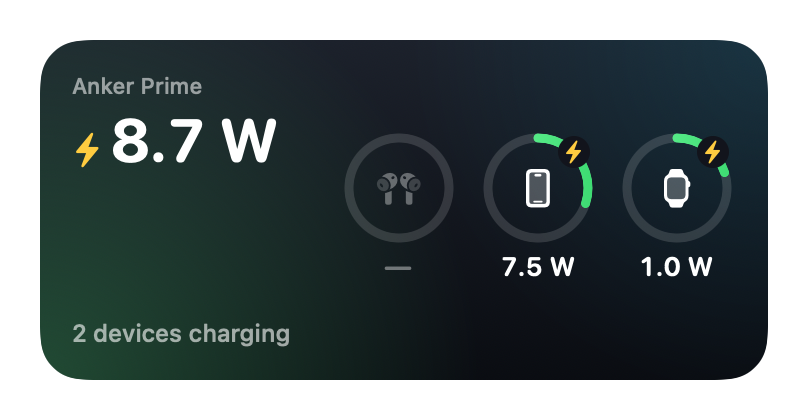
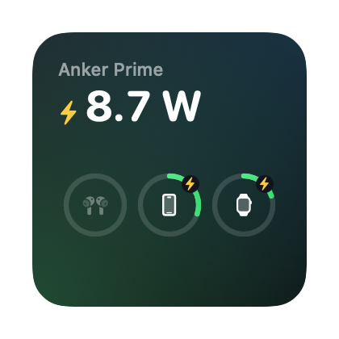

# AnkerBar

A macOS menu bar app and desktop widget for the **Anker Prime Wireless Charging Station 3-in-1 (A25X7)**.
It shows the charging power of each pad: phone, watch and earbuds.
The app reads the data from the charger over Bluetooth LE. You do not need the Anker app or an Anker account.

[Русская версия](README.ru.md) · [Website](https://andrewkomkov.github.io/anker-widget/) · [Download](https://github.com/andrewkomkov/anker-widget/releases/latest)

<p>
  
  
</p>

## Features

- Live power in the menu bar.
- Power, voltage and current for each pad in the menu.
- Small and medium desktop widgets. The widgets support the tinted and clear styles of macOS.
- English and Russian.
- One app with no dependencies. The Bluetooth protocol is written in Swift with CoreBluetooth and CryptoKit.

## Install

1. Download `AnkerBar.zip` from the [latest release](https://github.com/andrewkomkov/anker-widget/releases/latest).
2. Unzip it and move `AnkerBar.app` to the Applications folder.
3. Remove the quarantine flag. Apple did not notarize the app, thus macOS stops the first launch:

   ```bash
   xattr -dr com.apple.quarantine /Applications/AnkerBar.app
   ```

   As an alternative, open the app once. Then open System Settings, go to "Privacy and Security"
   and click "Open Anyway".
4. Open AnkerBar and allow Bluetooth access.
5. Right-click the desktop and click "Edit Widgets".
6. Find "Anker Prime" in the widget list.

macOS 15 or later is necessary.

## How it works

```
charger ──BLE──> AnkerBar.app ──state.json──> widget
                 (menu bar)     (app group)
```

- AnkerBar finds the first device that advertises the Anker service `ff09`. Then it does the
  handshake and receives telemetry.
- AnkerBar writes the state to the app group container and reloads the widget.
  The widget does not use Bluetooth.

## Protocol

The protocol is ported from [SolixBLE](https://github.com/flip-dots/SolixBLE) (MIT).

- Packet: `ff09 <length LE, 2 B> <pattern, 3 B> <command, 2 B> <payload> <XOR checksum, 1 B>`.
- Service `8c850001-0302-41c5-b46e-cf057c562025`. Commands go to `…0002`. Notifications come from `…0003`.
- The handshake uses AES-GCM with a static key. Then it uses ECDH on P-256 to make a session key.
  After that, all packets use AES-GCM with the session key.
- After the handshake, the app sends the subscribe command `4200`. Telemetry then comes as command `4300`.
- Pads are the TLV parameters `a2`, `a3` and `a4`. Each pad has 8 bytes, little-endian:
  `04 <status> <voltage, 0.01 V> <current, 0.01 A> <power, 0.01 W>`.
- Pad 1 is the earbuds, pad 2 is the phone and pad 3 is the watch.

Tested with one A25X7, firmware v0.0.5.2.

## Build from source

You need Xcode and [XcodeGen](https://github.com/yonaskolb/XcodeGen).

```bash
cd app
cp Local.xcconfig.example Local.xcconfig   # set your Team ID
xcodegen generate
xcodebuild -project AnkerBar.xcodeproj -scheme AnkerBar -configuration Release \
  -derivedDataPath build build
cp -R build/Build/Products/Release/AnkerBar.app ~/Applications/
```

The widget uses an app group, and the sandbox allows the app group only with a team signature.
The Team ID is the OU field of your Apple Development certificate.
If Xcode has no account, use manual signing in `Local.xcconfig`. The file has an example.

`tools/render_widget.swift` renders the widget views to PNG:

```bash
swiftc -parse-as-library -o /tmp/render app/Shared/ChargerState.swift \
  app/AnkerWidget/WidgetViews.swift tools/render_widget.swift
/tmp/render .
```

## Limits

- macOS limits widget reloads. The widget reloads immediately when a pad starts or stops.
  Other changes show at most once a minute. The menu bar always shows live values.
- If AnkerBar sends no data for 2 minutes, the widget shows the data as stale.

## License

MIT. Anker is a trademark of Anker Innovations. This project is not affiliated with Anker.
