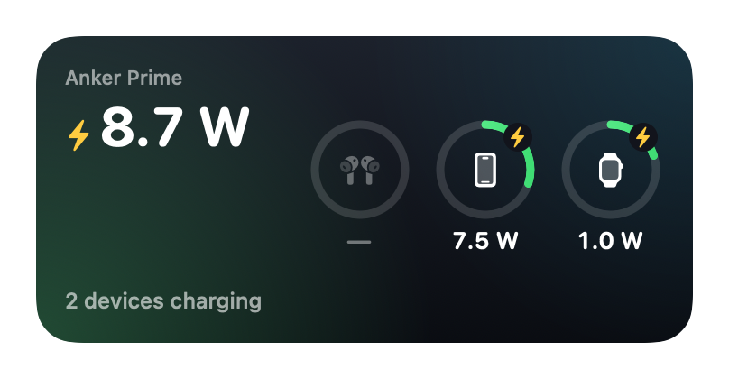
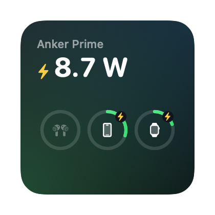

# AnkerBar

Приложение для строки меню и виджет macOS для зарядки **Anker Prime Wireless Charging Station 3-in-1 (A25X7)**.
Показывает мощность каждой площадки: телефон, часы, наушники.
Данные идут от зарядки по Bluetooth LE. Приложение Anker и аккаунт Anker не нужны.

[English](README.md) · [Сайт](https://andrewkomkov.github.io/anker-widget/) · [Скачать](https://github.com/andrewkomkov/anker-widget/releases/latest)

<p>
  
  
</p>

## Возможности

- Мощность в строке меню в реальном времени.
- Мощность, напряжение и ток каждой площадки в меню.
- Малый и средний виджеты. Виджеты поддерживают тонированный и прозрачный стили macOS.
- Английский и русский языки.
- Одно приложение без зависимостей. Протокол Bluetooth написан на Swift (CoreBluetooth и CryptoKit).

## Установка

1. Скачайте `AnkerBar.zip` из [последнего релиза](https://github.com/andrewkomkov/anker-widget/releases/latest).
2. Распакуйте архив.
3. Перенесите `AnkerBar.app` в папку «Программы».
4. Снимите карантин. Apple не заверяла приложение, поэтому macOS блокирует первый запуск:

   ```bash
   xattr -dr com.apple.quarantine /Applications/AnkerBar.app
   ```

   Другой способ — разрешить запуск в настройках. После первой попытки запуска в разделе
   «Конфиденциальность и безопасность» Системных настроек появится кнопка «Всё равно открыть».
5. Откройте AnkerBar.
6. Разрешите доступ к Bluetooth.
7. Добавьте виджет: правый клик по рабочему столу → «Изменить виджеты» → «Anker Prime».

Нужна macOS 15 или новее.

## Как устроено

```
зарядка ──BLE──> AnkerBar.app ──state.json──> виджет
                 (строка меню)  (App Group)
```

- AnkerBar находит первое устройство с сервисом Anker `ff09`, проходит рукопожатие и получает телеметрию.
- AnkerBar пишет состояние в контейнер App Group и обновляет виджет. Виджет не работает с Bluetooth.

## Протокол

Протокол перенесён из [SolixBLE](https://github.com/flip-dots/SolixBLE) (MIT).

- Пакет: `ff09 <длина LE, 2 Б> <шаблон, 3 Б> <команда, 2 Б> <данные> <XOR-сумма, 1 Б>`.
- Сервис `8c850001-0302-41c5-b46e-cf057c562025`. Команды идут в `…0002`, уведомления приходят из `…0003`.
- Рукопожатие зашифровано AES-GCM со статическим ключом. Потом стороны делают ECDH на P-256 и получают
  сеансовый ключ. Дальше все пакеты шифруются AES-GCM с сеансовым ключом.
- После рукопожатия приложение отправляет подписку `4200`. Телеметрия приходит командой `4300`.
- Площадки — TLV-параметры `a2`, `a3`, `a4`. Каждая занимает 8 байт little-endian:
  `04 <статус> <напряжение, 0,01 В> <ток, 0,01 А> <мощность, 0,01 Вт>`.
- Площадка 1 — наушники, 2 — телефон, 3 — часы.

Проверено на одной зарядке A25X7 с прошивкой v0.0.5.2.

## Сборка из исходников

Нужны Xcode и [XcodeGen](https://github.com/yonaskolb/XcodeGen).

```bash
cd app
cp Local.xcconfig.example Local.xcconfig   # впишите свой Team ID
xcodegen generate
xcodebuild -project AnkerBar.xcodeproj -scheme AnkerBar -configuration Release \
  -derivedDataPath build build
cp -R build/Build/Products/Release/AnkerBar.app ~/Applications/
```

Виджет использует App Group. Песочница разрешает App Group только при подписи с командой разработчика.
Team ID — это поле OU сертификата Apple Development. Если в Xcode нет аккаунта, включите ручную
подпись в `Local.xcconfig`: пример есть в файле.

## Ограничения

- macOS ограничивает частоту обновлений виджета. Виджет обновляется сразу, когда площадка начинает
  или прекращает зарядку. Другие изменения он показывает не чаще раза в минуту. В строке меню
  всегда живые значения.
- Если AnkerBar не присылает данные 2 минуты, виджет показывает их как устаревшие.

## Лицензия

MIT. Anker — товарный знак Anker Innovations. Проект с Anker не связан.
